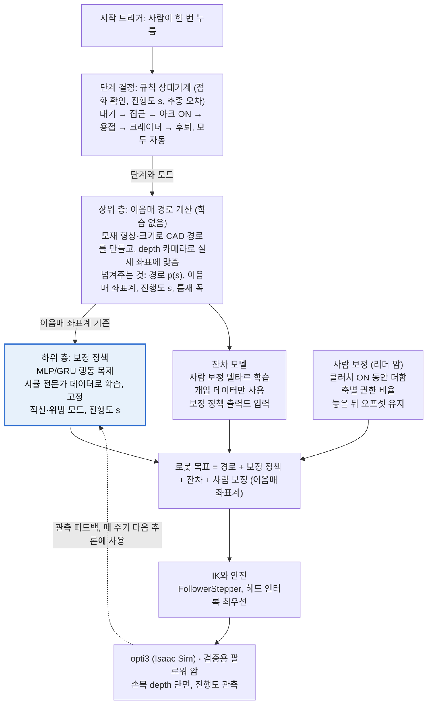

# 용접 로봇 아키텍처

## 요약

용접 로봇은 **사람이 시작 트리거를 누르면, 계산된 이음매 경로 위에서 학습 정책이 보정값만 내고, 숙련공은 언제든 리더 암으로 보정을 더하는** 계층 구조입니다. 이 문서는 현재 설계만 다룹니다. 설계마다 검토한 대안, 고른 이유, 바꿀 때 영향받는 곳은 [용접 로봇 설계 결정](docs/design-decisions.md)에 있습니다.

## 전체 구조

시작 트리거 하나가 단계 상태기계를 깨우고, 그 아래로 경로 계산, 세 가지 보정의 합성, IK와 안전 순으로 내려갑니다.

강조한 보정 정책만 시뮬 규칙 전문가 데이터로 학습하는 핵심 모델이고, 잔차 모델은 개입 데이터로 학습하며, 나머지는 계산이나 규칙으로 동작합니다. 로봇이 만든 관측은 매 주기 정책으로 돌아가므로, 사람이 보정하는 동안에도 모델은 추론을 이어 갑니다.

## 상위 층: 이음매 경로는 계산한다

경로는 학습하지 않고 계산합니다. 모재의 형상과 크기로 CAD 경로를 만들고 셀에 고정한 depth 카메라로 실제 위치에 맞춥니다. 용접 중 단면을 재는 손목 depth 카메라와는 별개입니다.

1. **CAD 경로:** 모재의 형상과 크기를 받아 CAD 모델에서 두 판의 교선을 이음매로 뽑고, 점마다 이음매 좌표계를 만듭니다.
2. **좌표 맞추기:** 고정 depth 카메라 점군에 CAD 모델을 정합(ICP)해, 모재가 로봇 기준 어디에 놓였는지 구합니다. 카메라와 로봇 사이 보정(hand-eye)이 미리 되어 있어야 합니다.
3. **경로 확정:** 명목 경로를 그 자세로 옮겨 p(s)를 정합니다. 학습 데이터에서는 ICP를 직접 돌리는 대신 실제 경로에 ICP 잔차 오차(분포에서 뽑음)를 더해 추정 경로를 만들고, 잔차 범위는 시편별 ICP 오차를 재서 맞춥니다. 규칙 전문가가 따라간 실제 경로에서 이 경로를 뺀 값이 보정값의 정답이 됩니다.

Isaac Sim에서는 USD 모재 형상에서 CAD 경로를 바로 뽑고, 모재 위치 오차와 틈새 변화를 일부러 섞어 시험합니다.

상위 층은 하위 층에 다음을 넘깁니다.

- **이음매 점열 p(s)와 이음매 좌표계:** x는 진행 방향, y는 좌우, z는 두 판 법선의 이등분 방향입니다.
- **진행도 s (0\~1):** 비드가 어디까지 왔는지를 알려 주는 값입니다.
- **형상 정보(있으면):** 틈새 폭, 홈 각도·깊이. 직선/위빙 선택과 위빙 폭 조절의 근거가 됩니다.
- **실시간 편차(손목 depth 카메라 단면):** 토치 앞 이음매 단면에서 잰 좌우·높이 오차와 틈새 폭, 두 판 면을 평면으로 맞춰 구한 작업각·진행각 오차. 맞대기 V홈에서는 두 개선 면에 평면을 맞추고, 홈 양옆 판 윗면 높이 차로 단차를 재서 좌우를 고칩니다. 단면은 토치 앞 30 mm에서만 재므로 이음매 시작 30 mm는 용접 중에 보이지 않습니다. 그래서 아크를 켜기 전에 손목 카메라로 시작 구간을 한 번 스캔해 버퍼를 미리 채웁니다. 스캔이 없으면 첫 가접이 있는 이 구간이 사각지대가 되어 남은 높이 오차의 대부분이 여기서 나옵니다.

## 단계 결정: 트리거 이후 전이는 자동

시작 트리거 뒤의 단계 전이는 사람 승인 없이 자동으로 실행합니다. 아크 ON/OFF와 크레이터는 단계 전이와 용접기 설정이 맡으므로 모방학습이 필요한 단계는 '용접' 하나입니다. 접근과 후퇴는 CAD와 depth로 구한 위치로 경로 계획을 합니다.

| 단계 | 하는 일 | 실행 주체 | 모방학습 데이터 |
| --- | --- | --- | --- |
| 대기 | 시작 트리거를 기다림 | 없음 | 불필요 |
| 접근 | 시작점 위로 이동, 아크를 켜기 전에 손목 카메라로 이음매 시작 30 mm 단면 스캔 | 경로 계획 | 불필요 |
| 아크 ON | 아크 점화 | 단계 전이 + 용접기 점화 설정 | 불필요 |
| 용접 | 경로를 따라 직선 또는 위빙, 어긋남 보정 | 보정 정책 + 잔차 모델 + 사람 보정 | 필요. 직선과 위빙 둘 다, 어긋남이 있는 상황 위주 |
| 크레이터 | 끝점에서 멈추거나 살짝 되돌아와 낮은 전류로 0.2\~1초 유지한 뒤 아크 OFF | 일반 제어기(멈춤·되돌림) + 용접기 크레이터 설정 | 불필요 |
| 후퇴 | 토치를 빼고 대기 위치로 | 경로 계획 | 불필요 |

전이는 코드의 규칙 상태기계가 정합니다. 단계마다 넘어가는 조건은 다음과 같습니다.

1. **대기 → 접근:** 시작 트리거가 눌리고 경로 계산이 끝나면 넘어갑니다.
2. **접근 → 아크 ON:** 시작 구간 스캔이 끝나고 토치가 시작점의 용접 자세에 도달해 위치·자세 오차가 임계값 안에 들어오면 넘어갑니다.
3. **아크 ON → 용접:** 용접기가 점화(전류 감지)를 알리면 넘어갑니다. 정해진 시간 안에 점화되지 않으면 아크를 끄고 후퇴합니다.
4. **용접 → 크레이터:** 진행도 s가 1(경로 끝)에 닿으면 넘어갑니다.
5. **크레이터 → 후퇴:** 용접기의 크레이터 시간이 끝나고 아크 OFF가 확인되면 넘어갑니다.
6. **후퇴 → 대기:** 토치가 대기 위치에 도달하면 넘어갑니다.

상태기계가 지키는 규칙입니다.

- **안전 쪽 전이:** 용접 중 추종 오차가 임계값을 넘거나, 손목 depth 카메라가 일정 시간 이음매 단면을 잃거나, IK가 실패하면 아크를 끄고 일시정지합니다. 재개는 사람이 시작 트리거를 다시 눌러서 합니다.
- **임계값:** `tracking_error_high`처럼 코드가 계산한 플래그로 판단하고, 값은 Isaac Sim 로그로 정합니다.
- **하드 인터록 우선:** 비상정지, 충돌, 작업공간 이탈은 하드 인터록이 상태기계보다 항상 우선합니다.
- **조종 주체는 따로:** 사람과 모델 중 누가 조종할지는 상태기계가 아니라 클러치와 축별 권한 규칙이 정합니다.

아크 ON/OFF는 상태기계가 아크 ON 또는 크레이터 단계로 전이할 때 코드가 용접기에 보내고, 크레이터 전류와 시간은 용접기 설정값을 씁니다. 그 밖의 점화 명령은 하드 인터록이 막습니다. 시뮬과 시연 환경에는 실제 용접기가 없으므로, 점화 확인과 아크 OFF 확인은 정해진 시간 뒤에 들어오는 가상 신호(타이머)로 대신합니다.

## 하위 층: 보정 정책은 오차와 변화만 메운다

정책은 기본 궤적(직선, 또는 정해진 위빙 패턴)과 실제 사이의 차이만 메웁니다. 경로 위치, 단계 전이, 아크는 계산과 설정이 맡고, 정책이 맡는 일은 두 가지입니다.

1. **남은 위치 오차 보정:** depth 카메라의 mm 단위 오차, CAD와 실물의 차이, 가접이나 지그 때문에 생긴 어긋남을 좌우·높이 오프셋으로 메웁니다.
2. **용접 중 변화 대응:** 열변형, 모재 밀림, 틈새 폭 변화에 따라 좌우·높이, 토치 각도, 위빙 폭, 진행 속도를 조정합니다.

- **행동:** 이음매 좌표계 기준 보정값입니다. 진행각·작업각, 위빙 진폭·주기, 진행 속도, 높이(CTWD), 좌우 오프셋. 아크 ON/OFF와 크레이터는 정책 행동에 넣지 않습니다. 관절각이 아니라서 로봇 자세나 팔이 달라도(시뮬의 opti3, 실기 검증의 팔로워 암) 각 팔의 IK만으로 그대로 쓰고, 사람 보정도 같은 좌표계라 그대로 더할 수 있습니다.
- **관측:** 손목 depth 카메라로 토치 앞 이음매 단면을 재서 얻은 좌우·높이 편차, 틈새 폭, 두 판 면 기울기로 구한 작업각·진행각 편차(모두 진행 거리 기준 버퍼), 진행도 s, 모드. 작업각은 뿌리 위치를 바꾸지 않아서 판 면 기울기 없이는 정책이 알 수 없습니다. 카메라 영상, 관절각, 토치 자세는 넣지 않습니다. 영상은 시뮬과 실기의 배경·조명 차이가 크고, 관절각을 빼야 팔이 바뀌어도 그대로 씁니다. 토치 자세는 직전 명령과 거의 같아서, 넣으면 정책이 단면 대신 직전 명령을 따라 하는 지름길을 배우고 닫힌 루프 오차가 커집니다. 단면 편차는 잴 때의 토치 자세로 이미 추정 경로 기준으로 바꿔 두므로 따로 넣지 않아도 됩니다. 실기 검증은 아크 없는 시연 환경이라 depth 단면이 아크 빛에 가려지지 않습니다.
- **조건 입력:** 직선/위빙 모드(원-핫)와 진행도 s를 상태 뒤에 붙입니다. 학습 대상이 용접 단계 하나라 단계 ID는 넣지 않습니다. 공칭 용접 조건(WPS: 속도, 위빙, 각도)은 고정값으로 시작해 기본 궤적에만 쓰고 조건 입력에는 넣지 않습니다. 같은 관측에 모드만 바꿔 넣어 행동이 달라지는지로 조건이 쓰이는지 확인합니다.
- **범위가 좁아서 생기는 결과:** 출력이 수 mm, 몇 도 수준이라 범위를 제한하기 쉽고, 정책이 틀려도 크게 벗어나지 않습니다. 대신 학습 데이터에 어긋남이 꼭 들어 있어야 해서, Isaac Sim에서 모재 오차를 분포로 주입하고 실제 경로를 아는 규칙 전문가로 기하 보정 데이터를 만듭니다. 평가는 보정 0인 규칙 궤적보다 실제 이음매에 더 가까운지(정답 대비 남은 오차)와 추종 오차로 합니다. 시뮬과 시연에는 비드가 없어 비드 품질은 평가하지 않습니다.

정책 모델은 위 저차원 입출력을 그대로 쓰는 작은 MLP 또는 GRU 행동 복제입니다. 단면 편차는 추정 경로 기준이라 토치가 어디 있든 같은 값이 나오므로, 정책 출력이 다음 관측을 바꾸지 않습니다. 그래서 정책이 직접 몰아도 학습 데이터에 없던 상태로 벗어나며 오차가 쌓이지 않고, 시뮬 규칙 전문가 DAgger는 나중으로 미뤘습니다. 정책 출력에 따라 관측이 바뀌게 되면(토치를 따라 움직이는 카메라 시야를 모델링하거나 그런 입력을 넣을 때) 다시 넣습니다. 입력이 수십 개 숫자이고 출력이 수 mm, 몇 도 범위라 큰 모델이 필요 없고, 매 주기 한 스텝씩 행동을 내므로 사람 보정에 바로 반응합니다. 잔차 모델도 같은 형태의 작은 MLP 또는 GRU입니다.

정책은 시편군마다 따로 두지 않고 모든 시편군(지금은 T 필릿, ㄱ자 코너 필릿, 맞대기 V홈) 에피소드를 합쳐 MLP 하나로 학습합니다. 관측과 행동이 이음매 기준이라 시편군과 무관하고, 합쳐 학습한 정책이 각 군만으로 학습한 정책보다 세 군 모두에서 낫거나 같았습니다([learning/README.md](learning/README.md)). 시편군은 정책 입력에 넣지 않습니다.

## 사람 개입: 모델은 멈추지 않고 사람 보정을 더한다

숙련공이 견습생의 손 위에 손을 얹고 미는 방식입니다. 모델은 개입 중에도 매 주기 바뀐 상태를 관측하고 추론을 이어 갑니다.

$$
T_{target} = T_{path}(s) \cdot \Delta T_{base} \cdot \Delta T_{residual} \cdot \Delta T_{human}
$$

로봇 목표 = 이음매 경로(진행도 s) + 보정 정책 + 잔차 모델 + 사람 보정이고, 네 항 모두 이음매 좌표계 기준입니다.

- **클러치는 보정 스위치:** 클러치는 사람 보정을 켜고 끄는 역할만 하고, 작업 시작은 시작 트리거가 따로 맡습니다.
- **더하기:** 클러치 ON 동안 리더 변화량(누른 순간 대비)을 이음매 좌표로 바꿔 더합니다. 기본 권한은 높이·좌우·토치 각도는 사람, 진행과 위빙은 모델이 맡습니다. 필요하면 축마다 비율을 바꿀 수 있고, 모든 축을 사람 100%로 두면 완전한 넘겨받기가 됩니다.
- **놓은 뒤 기억:** 클러치를 놓을 때의 사람 보정을 버리지 않고 오프셋으로 유지합니다. 토치를 2 mm 올리고 놓으면 그 높이에서 이어 갑니다. 더 필요 없어지면 작업자가 오프셋 초기화 버튼으로 오프셋을 0으로 되돌리고, 토치가 튀지 않도록 짧은 시간에 걸쳐 줄입니다.
- **진행까지 넘겨받았다 돌려줄 때:** 토치 위치를 경로에 투영해 그 s부터 이어 갑니다. 정책은 매 주기 현재 관측으로 추론하므로 돌려받은 다음 주기부터 바로 이어 갑니다.
- **반응 속도:** 정책은 매 주기 한 스텝씩 행동을 내므로, 사람 보정과 바뀐 관측에 다음 주기에 바로 반응합니다.

## 텔레옵과 실행 기반: 지금 코드 위에 얹는다

리더에서 팔로워까지 자세를 전달하는 부분은 PR #6까지로 갖춰져 있고, 트리거, 경로, 정책, 기록은 새로 만들어야 합니다.

| 구성 요소 | 지금 하는 일 | 이 아키텍처에서 |
| --- | --- | --- |
| `FeetechDriver` ([`leader_drivers.py`](weld_teleop/weld_teleop/leader_drivers.py)) | SO-102 리더 7축 읽기 (lerobot은 이 배치를 잘못 읽음) | 그대로 사용 |
| `EeMapper` ([`mapping.py`](weld_teleop/weld_teleop/mapping.py)) | 클러치 순간 기준 상대 매핑, 주기당 이동량 제한 | 사람 보정 계산의 출발점. 로봇 목표를 대체하지 않고 이음매 좌표로 바꿔 더하도록 변경 |
| `FollowerStepper` ([`follower_control.py`](weld_teleop/weld_teleop/follower_control.py)) | opti3 IK, 관절 속도 제한, 추적 오차·리밋 정지 | 그대로 사용. 공유 제어 진입 시 내부 명령값을 실측값으로 동기화 |
| `TeleopLoop` ([`teleop_loop.py`](weld_teleop/weld_teleop/teleop_loop.py)) | 리더 FK → 매핑 → IK 1주기, 도달 범위 밖에서 재기준 | 상태기계의 단계 전이와 정책 입력을 받는 루프로 확장 |
| [`sim_bridge/`](sim_bridge/) | Isaac Sim 5.1 UDP 연결, Enter 키 클러치, 목표 마커 | 시험 환경으로 계속 사용 |

새로 필요한 것은 시작 트리거, 단계 상태기계(전이 조건과 임계값), 이음매 경로 계층(시뮬에서는 USD 모재에서 추출), 보정 정책과 잔차 모델의 추론 연결, 이음매 좌표 변환, LeRobotDataset 기록, 클러치 장치와 오프셋 초기화 버튼입니다.

**텔레옵 방식:** 리더 손끝의 움직임을 토치 끝이 따라가는 TCP 방식입니다. 이음매 좌표 보정과 사람 보정 더하기는 둘 다 TCP 변화량을 전제로 합니다.

## 데이터와 학습: 시뮬 학습 → 고정 → 개입 → 잔차

학습하는 모델은 두 개입니다. 보정 정책은 시뮬 규칙 전문가 데이터로 기하 보정을 학습한 뒤 고정합니다. 공유 제어 중 모인 사람 보정은 그 위에 얹는 작은 잔차 모델이 배우고, 보정 정책은 개입 데이터로 다시 학습하지 않습니다.

1. **시뮬 데이터 생성:** Isaac Sim에서 모재 오차(용접 전·중·후)를 분포로 주입하고, 실제 경로를 아는 규칙 전문가가 용접하며 정답(실제 경로 − 추정 경로)과 틈새에 따른 위빙·속도를 기록합니다. 에피소드는 학습하는 용접 단계만 담습니다. 로봇을 이음매 시작점 근처의 살짝 어긋난 자세에 바로 놓고 시작해 끝점에서 끝내며(시작 30 mm는 용접 전 스캔으로 단면 버퍼를 먼저 채움), 직선과 위빙 에피소드를 모두 만들고 모드를 함께 남깁니다. 시편, 배치, 수량은 [에피소드 생성 사양](https://claude.ai/artifact/5N8mRdnFyNv4fr8oVUcxU5)에 있고, 오차 종류와 범위는 [모재 오차 모델링 계획](https://claude.ai/artifact/UftNfNDdFX5SXsranrBDFk)과 [sim_errors/README.md](sim_errors/README.md)에 있습니다.
2. **보정 정책 학습:** 시뮬 데이터의 용접 단계 구간으로 보정 정책의 기하 보정과 틈새 규칙을 행동 복제로 학습한 뒤 고정합니다. 실기 데이터로 다시 맞추지 않으므로 입력은 시뮬과 실기에 똑같이 있는 것(depth 단면 편차와 판 면 기울기, 진행도 s, 모드)만 씁니다. 시뮬에는 용융지, 비드, 열이 없어 공정 반응은 여기서 배우지 않습니다.
3. **운용과 개입 수집:** 보정 정책이 용접하고 숙련공이 공유 제어로 보정합니다.
4. **잔차 모델 학습:** 정답은 그 시점에 적용 중인 사람 보정이고, 클러치를 놓은 뒤 유지되는 오프셋도 포함합니다. 보정도 유지 오프셋도 없는 구간과 작업자가 오프셋 초기화 버튼을 누른 뒤는 0입니다. 보정 직전 약 2초는 빼고, 보정 시작 직후는 촘촘히 샘플링합니다. 3과 4를 반복하고, 시편당 개입 횟수와 개입 크기가 더 줄지 않으면 멈춥니다. 개입 자체가 사람이 필요할 때만 끼어드는 DAgger(HG-DAgger)와 같은 구조라 잔차 모델에는 별도 DAgger 단계가 없습니다.

정상 에피소드에 거의 나오지 않는 장면(이음매 분실 후 복구, 넘겨받았다 돌려주기)은 일부러 상황을 만들어 추가로 모읍니다.

| 기록 항목 | 용도 |
| --- | --- |
| depth 단면 편차와 판 면 기울기, 진행도 s, 직선/위빙 모드 | 정책 관측과 조건 입력 |
| 카메라 이미지, 관절각, 단계 라벨 | 기록 전용 (확인과 분석, 정책 입력 아님) |
| 사람 보정값 (유지 오프셋 포함, 없으면 0), 오프셋 초기화 시점 | 잔차 모델 정답 |
| 보정 정책 출력, 잔차 출력, 실행된 합계, 아크 명령 | 분석과 재현 |
| 클러치 상태, 축별 권한 | 개입 구간 표시, 샘플링 가중치 |
| 단계 전이 시점과 걸린 조건 | 전이 조건과 임계값 검증 |

저장은 LeRobotDataset 형식으로 하고, 리더는 지금처럼 feetech 드라이버로 읽습니다. lerobot 0.6.1은 Python 3.12 이상이 필요한데, conda `weld` 환경이 3.12라 설치할 수 있습니다.

## 관련 문서

- [설계 결정](docs/design-decisions.md): 설계마다 검토한 대안, 고른 이유, 바꿀 때 영향받는 곳.
- [weld_teleop/README.md](weld_teleop/README.md): ROS2 텔레옵 노드 구성과 실행 방법.
- [sim_bridge/README.md](sim_bridge/README.md): 리더 암으로 Isaac Sim 안의 opti3를 움직이는 구성과 실행 방법.
- [sim_errors/README.md](sim_errors/README.md): Isaac Sim 모재 오차 시나리오와 규칙 전문가 에피소드 생성.
- [learning/README.md](learning/README.md): 에피소드 묶음 → LeRobotDataset 변환 → MLP/GRU 행동 복제 → 보정 0 대비 평가.
