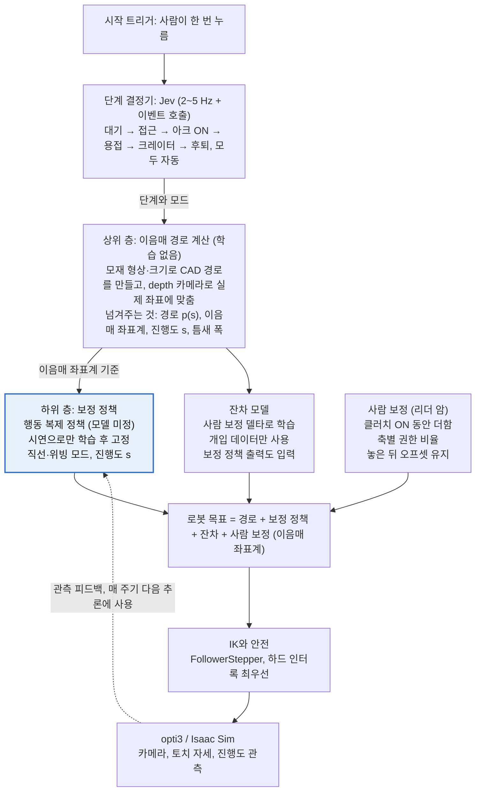

# 용접 로봇 아키텍처

## 요약

용접 로봇은 **사람이 시작 트리거를 누르면, 계산된 이음매 경로 위에서 학습 정책이 보정값만 내고, 숙련공은 언제든 리더 암으로 보정을 더하는** 계층 구조입니다. 이 문서는 현재 설계만 다룹니다. 설계마다 검토한 대안, 고른 이유, 바꿀 때 영향받는 곳은 [용접 로봇 설계 결정](docs/design-decisions.md)에 있습니다.

## 전체 구조

시작 트리거 하나가 단계 결정기를 깨우고, 그 아래로 경로 계산, 세 가지 보정의 합성, IK와 안전 순으로 내려갑니다.

강조한 보정 정책만 시연으로 학습하는 핵심 모델이고, 잔차 모델은 개입 데이터로 학습하며, 나머지는 계산이나 규칙으로 동작합니다. 로봇이 만든 관측은 매 주기 정책으로 돌아가므로, 사람이 보정하는 동안에도 모델은 추론을 이어 갑니다.

## 상위 층: 이음매 경로는 계산한다

경로는 학습하지 않고 계산합니다. 모재의 형상과 크기로 CAD 경로를 만들고 depth 카메라로 실제 위치에 맞추며, 학습과 추론에 같은 방식을 씁니다.

1. **CAD 경로:** 모재의 형상과 크기를 받아 CAD 모델에서 두 판의 교선을 이음매로 뽑고, 점마다 이음매 좌표계를 만듭니다.
2. **좌표 맞추기:** depth 카메라 점군에 CAD 모델을 정합(ICP)해, 모재가 로봇 기준 어디에 놓였는지 구합니다. 카메라와 로봇 사이 보정(hand-eye)이 미리 되어 있어야 합니다.
3. **경로 확정:** 명목 경로를 그 자세로 옮겨 p(s)를 정합니다. 시연에도 같은 방식으로 경로를 만들어, 숙련공의 동작에서 이 경로를 뺀 값이 보정값의 정답이 됩니다.

Isaac Sim에서는 USD 모재 형상에서 CAD 경로를 바로 뽑고, 모재 위치 오차와 틈새 변화를 일부러 섞어 시험합니다.

상위 층은 하위 층에 다음을 넘깁니다.

- **이음매 점열 p(s)와 이음매 좌표계:** x는 진행 방향, y는 좌우, z는 두 판 법선의 이등분 방향입니다.
- **진행도 s (0\~1):** 비드가 어디까지 왔는지를 알려 주는 값입니다.
- **형상 정보(있으면):** 틈새 폭, 홈 각도·깊이. 직선/위빙 선택과 위빙 폭 조절의 근거가 됩니다.
- **실시간 편차(용접 중 센서가 있으면):** 좌우·높이 방향 오차.

## 단계 결정: 트리거 이후 전이는 자동

시작 트리거 뒤의 단계 전이는 사람 승인 없이 자동으로 실행합니다. 아크 ON/OFF와 크레이터는 단계 전이와 용접기 설정이 맡으므로 모방학습이 필요한 단계는 '용접' 하나입니다. 접근과 후퇴는 CAD와 depth로 구한 위치로 경로 계획을 합니다.

| 단계 | 하는 일 | 실행 주체 | 모방학습 데이터 |
| --- | --- | --- | --- |
| 대기 | 시작 트리거를 기다림 | 없음 | 불필요 |
| 접근 | 시작점 위로 이동 | 경로 계획 | 불필요 |
| 아크 ON | 아크 점화 | Jev 단계 전이 + 용접기 점화 설정 | 불필요 |
| 용접 | 경로를 따라 직선 또는 위빙, 어긋남 보정 | 보정 정책 + 잔차 모델 + 사람 보정 | 필요. 직선과 위빙 둘 다, 어긋남이 있는 상황 위주 |
| 크레이터 | 끝점에서 멈추거나 살짝 되돌아와 낮은 전류로 0.2\~1초 유지한 뒤 아크 OFF | 일반 제어기(멈춤·되돌림) + 용접기 크레이터 설정 | 불필요 |
| 후퇴 | 토치를 빼고 대기 위치로 | 경로 계획 | 불필요 |

전이는 Jev가 고르고, Jev 앞뒤의 일은 코드가 맡습니다.

- **Jev의 역할:** 요약된 상태와 허용된 선택지를 받아 선택지별 확률을 한 번에 냅니다. 2\~5 Hz 주기 호출에 클러치 변화, 이음매 분실, IK 실패 같은 이벤트 호출을 더합니다. 사람과 모델 중 누가 조종할지는 Jev가 아니라 클러치와 축별 권한 규칙이 정합니다.
- **코드의 역할:** 입력을 요약하고 선택지를 걸러내며(아래 1, 2번), Jev 응답이 오기 전이나 끊겼을 때는 현재 단계를 유지합니다.

Jev 앞뒤의 코드가 지키는 규칙입니다.

1. 입력은 원시 신호가 아니라 수치와 플래그로 요약한 상태입니다. 임계값은 `tracking_error_high`처럼 코드가 미리 계산합니다.
2. 선택지는 현재 단계에서 허용된 전이만 넣고, 선택지별 결과(도달 가능 여부, 남은 거리)는 코드가 계산해 넣습니다. Jev는 입력에 없는 결과를 예측하는 데 약합니다 ([arXiv 2610.01834](https://arxiv.org/abs/2610.01834)).
3. 비상정지, 충돌, 작업공간 이탈은 하드 인터록이 단계 결정기보다 항상 우선합니다.
4. 신뢰도가 낮거나 응답이 늦으면 현재 단계를 유지하거나 일시정지 같은 안전 쪽 전이를 택합니다.

아크 ON/OFF는 Jev가 아크 ON 또는 크레이터 단계로 전이할 때 코드가 용접기에 보내고, 크레이터 전류와 시간은 용접기 설정값을 씁니다. 그 밖의 점화 명령은 하드 인터록이 막습니다.

Jev 입력 스키마, 호출 주기, 검증 절차는 [Jev 의사결정 모델 설계 고려사항](https://claude.ai/artifact/StWcQDXxRGm56MEgxkNRmt)에 있습니다.

## 하위 층: 보정 정책은 오차와 변화만 메운다

정책은 기본 궤적(직선, 또는 정해진 위빙 패턴)과 실제 사이의 차이만 메웁니다. 경로 위치, 단계 전이, 아크는 계산과 설정이 맡고, 정책이 맡는 일은 세 가지입니다.

1. **남은 위치 오차 보정:** depth 카메라의 mm 단위 오차, CAD와 실물의 차이, 가접이나 지그 때문에 생긴 어긋남을 좌우·높이 오프셋으로 메웁니다.
2. **용접 중 변화 대응:** 열변형, 틈새 폭 변화, 용융지 상태에 따라 진행 속도, 위빙 폭, 토치 각도를 조정합니다.
3. **기본 궤적이 담지 못하는 손기술:** 위빙 양 끝에서 잠깐 머무는 것처럼 규칙 궤적으로 표현하기 어려운 숙련공의 동작입니다.

- **행동:** 이음매 좌표계 기준 보정값입니다. 진행각·작업각, 위빙 진폭·주기, 진행 속도, 높이(CTWD), 좌우 오프셋. 아크 ON/OFF와 크레이터는 정책 행동에 넣지 않습니다. 관절각이 아니라서 opti3 자세가 달라도 일반화되고, 사람 보정도 같은 좌표계라 그대로 더할 수 있습니다.
- **관측:** 손목 카메라와 고정 카메라 1대, 토치 끝 자세와 관절각, 진행도 s, 이음매 센서 값과 아크 전류·전압(있을 때). 카메라는 아크 빛을 견뎌야 합니다. 정책은 관측에 보이는 오차만 고치므로, 용접 중 센서 없이는 용접 중 변화 대응(2번)이 거의 안 됩니다.
- **조건 입력:** 직선/위빙 모드(원-핫)와 진행도 s를 상태 뒤에 붙입니다. 학습 대상이 용접 단계 하나라 단계 ID는 넣지 않습니다. 같은 관측에 모드만 바꿔 넣어 행동이 달라지는지로 조건이 쓰이는지 확인합니다.
- **범위가 좁아서 생기는 결과:** 출력이 수 mm, 몇 도 수준이라 범위를 제한하기 쉽고, 정책이 틀려도 크게 벗어나지 않습니다. 대신 시연에 어긋남이 꼭 들어 있어야 해서, Isaac Sim에서 모재 위치 오차와 틈새 변화를 일부러 섞어 모읍니다. 평가는 보정 0인 규칙 궤적보다 추종 오차와 비드 품질이 나은지로 합니다.

정책 모델은 정하지 않았습니다. 시연으로 학습하는 행동 복제 정책이면 위 입출력에 그대로 들어갑니다.

## 사람 개입: 모델은 멈추지 않고 사람 보정을 더한다

숙련공이 견습생의 손 위에 손을 얹고 미는 방식입니다. 모델은 개입 중에도 매 주기 바뀐 상태를 관측하고 추론을 이어 갑니다.

$$
T_{target} = T_{path}(s) \cdot \Delta T_{base} \cdot \Delta T_{residual} \cdot \Delta T_{human}
$$

로봇 목표 = 이음매 경로(진행도 s) + 보정 정책 + 잔차 모델 + 사람 보정이고, 네 항 모두 이음매 좌표계 기준입니다.

- **클러치는 보정 스위치:** 클러치는 사람 보정을 켜고 끄는 역할만 하고, 작업 시작은 시작 트리거가 따로 맡습니다.
- **더하기:** 클러치 ON 동안 리더 변화량(누른 순간 대비)을 이음매 좌표로 바꿔 더합니다. 기본 권한은 높이·좌우·토치 각도는 사람, 진행과 위빙은 모델이 맡습니다. 필요하면 축마다 비율을 바꿀 수 있고, 모든 축을 사람 100%로 두면 완전한 넘겨받기가 됩니다.
- **놓은 뒤 기억:** 클러치를 놓을 때의 사람 보정을 버리지 않고 오프셋으로 유지합니다. 토치를 2 mm 올리고 놓으면 그 높이에서 이어 갑니다.
- **진행까지 넘겨받았다 돌려줄 때:** 토치 위치를 경로에 투영해 그 s부터 이어 갑니다. 미리 뽑아 둔 행동은 버리고 현재 관측으로 새로 추론합니다.
- **반응 속도:** 정책이 행동을 묶음으로 내면, 묶음을 짧게 실행하고 자주 다시 추론해야 사람 보정에 빨리 반응합니다.

## 텔레옵과 실행 기반: 지금 코드 위에 얹는다

리더에서 팔로워까지 자세를 전달하는 부분은 PR #6까지로 갖춰져 있고, 트리거, 경로, 정책, 기록은 새로 만들어야 합니다.

| 구성 요소 | 지금 하는 일 | 이 아키텍처에서 |
| --- | --- | --- |
| `FeetechDriver` ([`leader_drivers.py`](weld_teleop/weld_teleop/leader_drivers.py)) | SO-102 리더 7축 읽기 (lerobot은 이 배치를 잘못 읽음) | 그대로 사용 |
| `EeMapper` ([`mapping.py`](weld_teleop/weld_teleop/mapping.py)) | 클러치 순간 기준 상대 매핑, 주기당 이동량 제한 | 사람 보정 계산의 출발점. 로봇 목표를 대체하지 않고 이음매 좌표로 바꿔 더하도록 변경 |
| `FollowerStepper` ([`follower_control.py`](weld_teleop/weld_teleop/follower_control.py)) | opti3 IK, 관절 속도 제한, 추적 오차·리밋 정지 | 그대로 사용. 공유 제어 진입 시 내부 명령값을 실측값으로 동기화 |
| `TeleopLoop` ([`teleop_loop.py`](weld_teleop/weld_teleop/teleop_loop.py)) | 리더 FK → 매핑 → IK 1주기, 도달 범위 밖에서 재기준 | Jev 단계 전이와 정책 입력을 받는 루프로 확장 |
| [`sim_bridge/`](sim_bridge/) | Isaac Sim 5.1 UDP 연결, Enter 키 클러치, 목표 마커 | 시험 환경으로 계속 사용 |

새로 필요한 것은 시작 트리거, Jev 연결(상태 요약과 선택지 계산), 이음매 경로 계층(시뮬에서는 USD 모재에서 추출), 보정 정책과 잔차 모델의 추론 연결, 이음매 좌표 변환, LeRobotDataset 기록, 클러치 장치입니다.

**텔레옵 방식:** 리더 손끝의 움직임을 토치 끝이 따라가는 TCP 방식입니다. 이음매 좌표 보정과 사람 보정 더하기는 둘 다 TCP 변화량을 전제로 합니다.

## 데이터와 학습: 시연 → 고정 → 개입 → 잔차

학습하는 모델은 두 개입니다. 보정 정책은 시연으로만 학습해 고정하고, 공유 제어 중 모인 사람 보정은 그 위에 얹는 작은 잔차 모델이 배웁니다.

1. **시연 수집:** 접근부터 후퇴까지 전체 에피소드를 이어서 녹화하고, 시점별 단계 라벨과 직선/위빙 모드를 기록합니다. 아크 ON/OFF 시점은 정책의 정답은 아니지만, Jev 전이 검증에 쓰도록 함께 기록합니다. 단계별로 따로 모을 필요는 없습니다.
2. **보정 정책 학습:** 용접 단계 구간을 이음매 기준 보정값으로 바꿔 학습한 뒤 고정합니다.
3. **운용과 개입 수집:** 보정 정책이 용접하고 숙련공이 공유 제어로 보정합니다.
4. **잔차 모델 학습:** 정답은 사람 보정(델타)이고, 보정이 없는 구간은 0으로 넣습니다. 보정 직전 약 2초는 빼고, 보정 시작 직후는 촘촘히 샘플링합니다. 3과 4를 만족할 때까지 반복합니다.

정상 에피소드에 거의 나오지 않는 장면(이음매 분실 후 복구, 넘겨받았다 돌려주기)은 일부러 상황을 만들어 추가로 모읍니다.

| 기록 항목 | 용도 |
| --- | --- |
| 카메라 이미지, 토치 자세, 관절각, 진행도 s | 관측 |
| 단계 라벨, 직선/위빙 모드 | 조건 입력, 단계별 데이터 균형 |
| 사람 보정값 (보정 없는 구간은 0) | 잔차 모델 정답 |
| 보정 정책 출력, 잔차 출력, 실행된 합계, 아크 명령 | 분석과 재현 |
| 클러치 상태, 축별 권한 | 개입 구간 표시, 샘플링 가중치 |
| Jev 입력·출력·확률 | 전이 판단 검증 |

저장은 LeRobotDataset 형식으로 하고, 리더는 지금처럼 feetech 드라이버로 읽습니다. lerobot 0.6.1은 Python 3.12 이상이 필요한데, conda `weld` 환경이 3.12라 설치할 수 있습니다.

## 관련 문서

- [설계 결정](docs/design-decisions.md): 설계마다 검토한 대안, 고른 이유, 바꿀 때 영향받는 곳.
- [weld_teleop/README.md](weld_teleop/README.md): ROS2 텔레옵 노드 구성과 실행 방법.
- [sim_bridge/README.md](sim_bridge/README.md): 리더 암으로 Isaac Sim 안의 opti3를 움직이는 구성과 실행 방법.
- [sim_errors/README.md](sim_errors/README.md): Isaac Sim 모재 오차 시나리오와 규칙 전문가 에피소드 생성.
